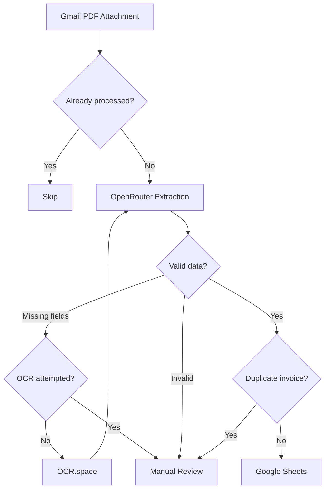

# AI Invoice Automation

Automated invoice processing with n8n, Gmail, OpenRouter, and Google Sheets.


## Overview

AI Invoice Automation is an n8n workflow that processes PDF invoices received through Gmail and stores validated invoice data in Google Sheets.

It combines AI-powered extraction, OCR fallback, data validation, and duplicate detection. Invoices that cannot be processed reliably are routed to manual review, with separate error logging for troubleshooting.

## Features

- Automatic Gmail PDF attachment processing
- Structured invoice extraction using OpenRouter
- OCR.space fallback for scanned or incomplete documents
- Validation of required fields, dates, currencies, and amounts
- Duplicate detection across emails and attachments
- Dedicated manual review and error logs
- Configurable processing limits, retries, and error handling

## Workflow



The workflow checks duplicates at two levels:

- **Attachment level:** Gmail message ID and attachment identifier.
- **Invoice level:** Normalized supplier, invoice number, invoice date, and currency.

Required fields include invoice number, date, supplier, total amount, and currency. Optional fields remain `null` when unavailable.

## Validation & Error Handling

Extracted records are validated before being written to Google Sheets.

| Condition | Handling |
| --- | --- |
| Duplicate attachment | Skip processing |
| Duplicate invoice | Route to manual review |
| Missing required fields | Attempt OCR fallback |
| Invalid JSON or inconsistent amounts | Route to manual review |
| OCR or extraction failure | Log error and route to review |
| Temporary API failure | Retry with bounded backoff |
| Google Sheets failure | Stop processing and log error |
| Invalid, encrypted, or oversized PDF | Route to review |

Financial validation includes checking that net amount plus tax matches the total within a configurable tolerance.

## Setup

### 1. Import

Import `invoice_automation_english.json` into n8n.

### 2. Connect services

Configure OAuth2 credentials for Gmail and Google Sheets.

Create separate Header Auth credentials for the HTTP Request nodes:

| Service | Header | Value |
| --- | --- | --- |
| OpenRouter | `Authorization` | `Bearer YOUR_OPENROUTER_KEY` |
| OCR.space | `apikey` | `YOUR_OCR_KEY` |

### 3. Configure Google Sheets

Create a spreadsheet with three tabs:

- `Invoices` — validated invoice records
- `Manual_Review` — invoices requiring attention
- `Error_Log` — technical errors and execution details

<details>
<summary>Required spreadsheet headers</summary>

**Invoices (A–Q)**

```text
Recorded At	Invoice Date	Invoice Number	Supplier	Total Amount	Currency	Net Amount	Tax Amount	Due Date	VAT ID	Description	Sender Email	Gmail Message ID	Attachment ID	Processing Status	Confidence	Duplicate Key
```

**Manual_Review (A–W)**

```text
Recorded At	Invoice Date	Invoice Number	Supplier	Total Amount	Currency	Net Amount	Tax Amount	Due Date	VAT ID	Description	Sender Email	Gmail Message ID	Attachment ID	Processing Status	Confidence	Duplicate Key	Review Reason	File Name	Subject	Received At	Execution ID	Review Key
```

**Error_Log (A–G)**

```text
Timestamp	Workflow Step	Error Category	Technical Reference	Error Message	Status	Execution ID
```

</details>

Header names and column order must match the workflow configuration.

### 4. Configure and activate

1. Set the spreadsheet ID, OpenRouter model, and validation settings in the `Config` node.
2. Configure the Gmail trigger filter.
3. Verify the assigned credentials and spreadsheet mappings.
4. Activate the workflow.

For manual reprocessing, use `Replay - Manual Trigger` with a Gmail API message ID.

## Deployment Notes

- Store API keys in n8n Credentials.
- Remove account-specific identifiers and saved execution data before sharing workflow exports.
- Invoice content is sent to external AI providers and, when OCR is used, to OCR.space.
- PDF processing is limited to 10 MiB per file. OCR requests are limited to 1 MB and 3 pages.
- Avoid concurrent executions when using Google Sheets for duplicate detection. Sheets does not enforce atomic uniqueness.
- Use a database with unique constraints if stronger concurrency guarantees are required.

The workflow includes error handling and manual review paths to prevent incomplete or invalid invoice records from being accepted automatically.

---

*Test data uses fictional companies and synthetic transactions.*
